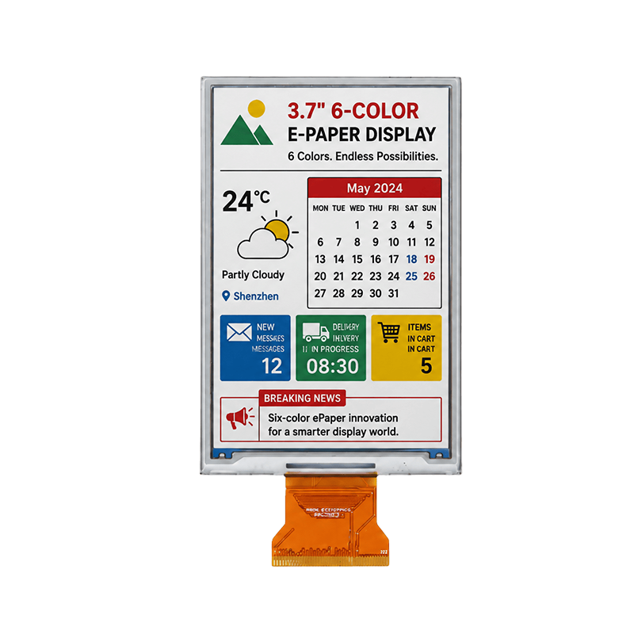

<p align="left"></p>

<div align="center">

# OSPTEK 3.7″ EPD 显示屏 480×720

**EPD 模组 · 多版本资料索引**

[简体中文](./README.md) &nbsp;/&nbsp; [English](./README_EN.md)


</div>

<br>

## 目录

| | |
| :--- | :--- |
| [说明](#说明) | 本仓库收录什么、怎么使用 |
| [版本一览](#版本一览) | 各版本实物图与参数，进入对应料号资料 |
| [仓库结构](#仓库结构) | 目录说明，资料放在哪里 |
| [示例工程](#示例工程) | 驱动与示例代码 |
| [固件](#固件) | 固件文件与在线烧录 |
| [购买链接](#购买链接) | 淘宝、速卖通官方店铺 |
| [技术支持](#技术支持) | 联系方式 |

<br>

## 说明

本仓库收录 **3.7 寸 480×720 EPD** 显示模组资料。同一规格下可能有多个版本，驱动芯片、触摸方案、接口等细节以 `versions/` 下各版本自己的 README 为准。

> [!NOTE]
> **根目录 README 为导航页。** 点击下方版本图片或「完整资料」，进入 `versions/` 下对应**料号文件夹**（产品页、规格书等资料均在该目录内）。示例工程与固件不区分版本，统一放在仓库根目录。

规格标识（仓库名）：`display-epd-3.7inch-480x720`

<br>

## 版本一览

<table>
  <tr>
    <td align="center" width="50%">
      <a href="./versions/EPD037A02/"></a>
      <br>
      <b>EPD037A02</b>
      <br>
      <sub>— · SPI · 触摸 — · <a href="./versions/EPD037A02/">完整资料 →</a></sub>
    </td>
    <td></td>
  </tr>
</table>

<sub>

| 版本 | 驱动 IC | 触摸驱动 | 接口 | |
| :--- | :--- | :--- | :--- | :--- |
| EPD037A02 | — | — | SPI | [完整资料](./versions/EPD037A02/) |

</sub>

<br>

## 仓库结构

```text
display-epd-3.7inch-480x720/
├── README.md / README_EN.md    本页：规格导航
├── LICENSE                     许可证（CC BY 4.0）
├── images/                     仓库公共图片
├── versions/                   各版本（料号）完整资料
│   └── <料号>/
│       ├── README.md           规格参数与资料清单
│       ├── osptek.yml          结构化参数
│       ├── datasheets/         产品规格书、驱动 / 触摸 IC 数据手册
│       ├── cad/                外形 / 盖板 CAD
│       ├── code/               初始化参考代码
│       ├── images/             产品图片
│       ├── adapter/            转接板资料与图片
│       └── misc/               其他资料
├── examples/                   示例工程（各版本通用）
└── firmware/                   固件文件
```

<br>

## 示例工程

[`examples/`](./examples/) 中收录了可直接编译运行的驱动与示例代码，覆盖常见主控平台与开发环境，帮助你快速点亮屏幕、验证显示效果。

- **适用范围**：示例不区分版本，同一规格下的各型号共用。不同版本的驱动 IC 与接口不同，**使用前请对照上方「版本一览」确认你手上的型号**，再选择对应的示例或初始化参数。
- **怎么使用**：每个示例文件夹内都有独立的 README，说明所用平台、接线方式、编译与运行步骤，按其操作即可。
- **更多参考**：各版本目录下的 `code/` 提供初始化参考代码，可与示例对照使用。
- **欢迎贡献**：如果你基于本屏幕做了新的移植或应用，欢迎通过 Pull Request 提交到 `examples/`。

<br>

## 固件

[`firmware/`](./firmware/) 文件夹存放本规格屏幕可直接使用的**预编译固件**。不需要搭建开发环境、不需要编译，下载后烧录到开发板，就能马上看到屏幕点亮和显示效果，适合快速验证屏幕是否正常、对比不同型号的显示表现，也适合在没有开发经验的情况下直接体验。

<p align="center">
  <a href="https://www.yy.fyi/"></a>
</p>

**方式一：在线烧录**

用我们的在线固件烧录网站，不用安装任何软件，浏览器里就能完成：

1. 用数据线把开发板连接到电脑；
2. 点击上方「在线烧录固件」按钮，选择要烧录的固件；
3. 点击连接设备，等待烧录完成。

**方式二：下载固件，本地烧录**

1. 进入 [`firmware/`](./firmware/) 文件夹，下载与你型号匹配的固件文件；
2. 使用你习惯的烧录工具，按固件说明将其烧录到开发板。

> [!TIP]
> 在线烧录请使用支持 Web Serial 的浏览器（如 Chrome、Edge），并确认数据线支持数据传输，而不是仅供充电。

**使用须知**

- 固件与硬件配套：不同版本的驱动 IC 与接口不同，请先在上方「版本一览」确认你的型号，再选择匹配的固件。
- 固件文件按平台与功能命名，每个固件旁附有说明，请按说明选择。
- 如果需要修改功能或移植到自己的项目，请参考上方「示例工程」获取源码。
- 烧录或使用中遇到问题，欢迎在 [Issues](../../issues) 反馈，或联系技术支持。

<br>

## 购买链接

<table>
  <tr>
    <td width="50%" valign="top">
      <sub>国内</sub>
      <br>
      <b>淘宝 · 鱼鹰光电工厂店</b>
      <br>
      <br>
      <a href="https://shop110742373.taobao.com/"></a>
    </td>
    <td width="50%" valign="top">
      <sub>海外</sub>
      <br>
      <b>AliExpress · OSPTEK Official Store</b>
      <br>
      <br>
      <a href="https://www.aliexpress.com/store/1105701619"></a>
    </td>
  </tr>
</table>

<br>

## 技术支持

<table>
  <tr>
    <td width="33%" valign="top">
      <sub>技术支持 / 产品咨询</sub>
      <br>
      <b><a href="mailto:luyu@osptek.com">luyu@osptek.com</a></b>
    </td>
    <td width="33%" valign="top">
      <sub>QQ 技术交流群</sub>
      <br>
      <b>985881096</b>
    </td>
    <td width="33%" valign="top">
      <sub>问题反馈</sub>
      <br>
      <b><a href="../../issues">在 Issues 中提问</a></b>
    </td>
  </tr>
  <tr>
    <td valign="top">
      <sub>公司官网</sub>
      <br>
      <b><a href="https://osptek.com/">osptek.com</a></b>
    </td>
    <td valign="top">
      <sub>在线固件烧录</sub>
      <br>
      <b><a href="https://www.yy.fyi/">点击进入</a></b>
    </td>
    <td valign="top">
      <sub>淘宝 / 速卖通</sub>
      <br>
      <b><a href="#购买链接">购买链接</a></b>
    </td>
  </tr>
</table>

<br>

---

<p align="center"><sub>© 2026 OSPTEK 鱼鹰光电 · 本仓库资料采用 CC BY 4.0 许可</sub></p>
